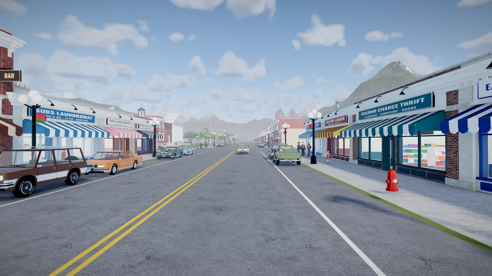

# Pine Hollow: a Pacific Northwest lake town (Three.js)

Pine Hollow is a small 1980s lake town in a Pacific Northwest valley, built in **Three.js**. Buildings are full size and can be walked into, the streets are dressed with parked cars, people, poles, signs and litter, and you can drive or walk anywhere. The models are original, made in Blender in a mid-poly style: bevelled, flat-coloured and readable, between blocky low-poly and photoreal. All shop names, signs and logos are invented.



## The town

The town sits between the river to the north and the lake to the south. Highway 10 comes in from both ends of the valley, slows into a commercial strip on the west side and becomes Main Street through four blocks of downtown. Around that core the streets bend with the ground: Riverside Dr loops round the north side, Alder St round the south, and the residential streets, the hillside drive and the lanes of the poor end all curve off them.

**Road hierarchy.** Thirteen road classes, each with its own width, kerbs, markings and speed:

| Class | Roads |
|---|---|
| **Highway** | Old Hwy 10 west and east (two lanes, double yellow, gravel shoulders) |
| **Commercial strip** | W Main St |
| **Downtown** | Main St, Division St (parking lanes, wide sidewalks, crosswalks) |
| **Collectors** | Riverside Dr, Alder St, Lakeshore Dr, E Main St, 1st Ave E and W |
| **Residential** | Maple St, Lake Hill Rd, 2nd and 3rd Aves, Division St S, Birch Ct, Heron Ct |
| **Hillside** | Ridgecrest Dr, Lakeview Ct |
| **Lane** | Tannery St |
| **Alleys** | Alley S, Alley NW, Alley NE behind the Main Street blocks |
| **Rural and gravel** | County Rd 5, Mill Rd, Cannery Rd, Freight Rd, Depot Rd, Slough Rd, Pine Loop and the farm roads |

| District | What's there |
|---|---|
| **Main Street** | Continuous two-storey brick terraces on both sides (hardware, barber, pharmacy, records, gazette, bakery, tavern, pawn, antiques, insurance, thrift, video, laundry, liquor) and First Cascade Bank with its own customer lot. Behind every terrace: a service alley, a rear parking lot, back doors with fire escapes, dumpsters, wheelie bins, pallets, cardboard, bags and litter, patched and stained asphalt, drains, pole lines with overhead wires, fences and weeds. |
| **Town Hall Square** | Pine Hollow Town Hall on its own block with lawns, paths, a flagpole, the bandstand, fountain, statue and war memorial, benches, old street lamps and a car park. |
| **Courthouse Square** | The Hollow County Courthouse on a separate block with lawns, paths and its own car park, with the Hollow County Sheriff and its patrol cars alongside; the Community Church stands on its own lot. |
| **West strip** | Timberline Gas, Dottie's Diner, the Pine Rest Motel, Hollow Foods Market behind a full car park, and the Hollow Motors used-car lot, each with pole signs, lot lighting and service yards. |
| **Homes** | Curving residential streets with driveways, parked cars, fences, sheds, bins and yard trees. |
| **Cedar Ridge** | The wealthy hillside: large houses on big wooded lots along Ridgecrest Dr and Lakeview Ct, with hedges, topiary, pools, patios and better cars. |
| **The Flats** | The poor end on Tannery St and Slough Rd: small weathered houses close to a patched lane, cars on the verge, chain-link, junk and bare dirt in the yards. |
| **Whispering Pines** | A trailer park on a gravel loop: single-wides with clotheslines, grills, bikes and kiddie pools, a propane tank, a payphone, a small playground and shared dumpsters. |
| **Highway 10 east** | The working edge of town: Hollow Auto Wrecking, the Hwy 10 Truck Park, Cascade Builders Supply and Ridgeline Plant Hire, each a fenced yard with its own office, stock, plant and signs. |
| **Lakefront** | The Loon Lakeside Café with its deck, Bait & Tackle, a pier with boats and buoys, the beach, a playground and picnic tables. |
| **Farms** | Ten farms along the valley roads: barn, machine shed, farmhouse, silos or grain bins, windmill, paddock with cattle, corn field, hay, tractor and pickup. |
| **Lumber yard (Mill Rd)** | Hollow Creek Lumber Co.: sawmill, office, drying sheds, stacked timber, log decks, a log loader and trucks inside a fenced gravel yard. |
| **Freight district** | Cascade Freight & Storage warehouses, a container yard, Pine Hollow Canning Co., the grain elevator and the water tower. |

**Interiors.** The landmarks, shops, houses and district buildings have furnished interiors behind real glass: wood floors, wainscot walls, tiled ceilings and furniture modelled for that kind of place (courtroom and clerk's office, diner booths and counter, bank counter and vault, jail cells, church pews, shop shelving, motel rooms, kitchens and living rooms, barn stalls and loft, warehouse racking).

**People.** About 380 townsfolk live in the town. They are 36 boxy characters modelled and rigged in Blender (deputies, farmer, mechanic, lumberjack, waitress, cook, priest, kids, tourists and more), on one skeleton with 56 authored animations and 15 hand props.

- **Lives.** Each person has a name, a job and workplace or a role (local, kid, elder, tourist, jogger), a home, traits, friends and five needs (hunger, energy, company, fun, errands). A daily schedule and the needs are scored against each other to pick what to do next.
- **Getting around.** They walk the sidewalks, wait at the kerb for traffic, cross at the corners, go in and out of buildings through the doors and take a seat or a spot at the counter inside. Cars slow for people on a crossing.
- **Things they do.** Talk, listen, laugh and wave in groups; sit, eat, drink and read; phone, smoke, lean and stretch; sweep, rake, hammer, garden, fish, carry boxes, serve and work a counter or a desk.
- **Reactions.** They step round each other and the player, look at and greet the player, flinch and get out of the way of a car, put up umbrellas or run for shelter when it rains, and go home at night.
- **On foot.** Walk up to anyone to see their name, job and what they are doing.

**Vehicles.** 30 vehicles from the 1970s and 80s: sedans, coupes, a muscle car, a woody wagon, pickups, an SUV, vans, police cars, a tow truck, semis with box, tanker and log trailers, a dump truck, a flatbed, a school bus, a farm tractor and a log loader.

**Town map.** Press `M` while driving. The map is hill-shaded and shows district outlines and names, every named place (colour-coded by type), street names, a legend and a scale bar. The HUD shows the street and district you're in.

**Junctions.** Every T-junction and crossing has curb returns: the side street's asphalt flares into a rounded corner, and the curb, planting strip and sidewalk wrap round it. Roads are cut exactly at the edge of the road they meet. Where two kerbed streets meet, every lane line stops at a zebra crosswalk and the junction box is left clear, with a stop bar on the minor approach; elsewhere the through road keeps its markings. Stop signs, lamps and hydrants stay off the junction. A layout audit at start-up checks every building footprint and its front steps against the streets and reports any overlap. Bridges carry roads over the river.

**Terrain and collision.** The ground is graded to meet every road, and terrain cells beside roads are split to about 4 m so the ground follows cuts, fills and curbs; it is always kept just under the road surface so it never pokes through. Vehicles ride on the drawn ground mesh, not an invisible approximation of it, so there are no bumps where nothing is visible, and they drive on carriageways, curb returns, sidewalks and bridge decks.

**Textures.** Asphalt, gravel road and sidewalk concrete are CC0 photo textures from Poly Haven, high-pass filtered to a neutral grey so each road's colour still comes through; sidewalks are scored into 1.5 m slabs.

**Sky and water.**
- **Physical sky** (after leoawen/volumetric_cloud_atmosphere_scattering): single-scattering atmosphere with Rayleigh, Mie and ozone, a sun disc, and raymarched volumetric clouds built from baked 3D Perlin-Worley and Worley noise, lit with Beer + powder and a two-lobe phase function. It renders at half resolution with temporal reprojection, and the same shader feeds the environment map, so reflections and ambient light match the sky. Each preset sets its own cloud cover (fair-weather cumulus on a clear day, a solid deck for drizzle). `?sky=hdri` brings back the old Poly Haven HDRI dome.
- **Water** (after jeantimex/threejs-water): a heightfield ripple simulation follows the camera across the river and lake (raindrops in wet weather, the odd rising fish), and the surface is physically based: Fresnel reflection of the sky, flow-aligned waves on the river, wind ripples on the lake, colour and clarity from the water depth, and foam along the shore.

**Atmosphere.** The town starts at a clear late morning, like the reference look, and the weather then changes by itself. On top of the sky:
- exponential height fog that pools in the valley, with sun in-scattering;
- drifting mist banks over the forest, river and lake;
- rain-darkened glossy roads with puddles;
- windows that light up at dusk;
- a filmic grade plus light film grain.

Presets: **Clear Day**, **Morning Fog**, **PNW Mist**, **Overcast Drizzle**, **Golden Hour**, **Dusk**, **PNW Thick Fog** and **Rain**. `?hour=<0-24>` and `?front=clear|mist|overcast|rain|fog` set the starting time and weather.

## Run

```bash
npm install
npm run dev        # http://localhost:5173  (gallery: /gallery.html?set=b2|people|... &only=id1,id2)
npm run build      # static build in dist/
```

URL options:
- `?shot=<id>`: main, green, courthouse, church, gas, donut, lakefront, maple, aerial, valley, motel, grocery, lumber, freight, cannery, farm, dairy, east, west, river.
- `?atmo=pnwmist|overcastdrizzle|goldenhour|dusk|clearday`, `?quality=low|medium|high`, `?ui=0`, `?tour=1`, `?traffic=0`, `?ao=0`.
- `?still=1` renders a few frames and then idles. Use it for headless or software-GL screenshots.

## Controls

**Exploring:** `1`–`0` camera presets · `N` next shot · `T` cinematic tour · `F` free-fly (WASD, Q/E, Shift) · `H` hide UI · mouse drag to orbit.

**Driving (`V` to get in or out):**
- `W`/`S` throttle and brake (hold `S` to reverse) · `A`/`D` steer · `Space` handbrake · `Shift` boost.
- `C` cycles the camera: chase, far chase, cockpit. Drag the mouse to look around.
- `R` resets to the nearest road · `M` full map.
- `F` (or `E`) steps out of the car where it stands, and gets back in when you are next to it.

**On foot (`G` to start walking where the camera looks):**
- `W`/`A`/`S`/`D` move relative to the camera · `Shift` run · `Space` jump · drag the mouse (or `←`/`→`) to look, wheel to zoom.
- Walk through any open door: every Main Street shopfront, the diner, the gas-station mart, the sheriff's office and jail, the courthouse (up the front steps) and the ranch houses are furnished rooms behind real glass.
- You wade, then swim, in the river and lake. `V` or `Esc` returns to the free camera.

**Driving model.** Each vehicle has an engine torque curve, an automatic gearbox with shift delay and engine braking, a friction-circle tyre model with slip angles and weight transfer, rear- or four-wheel drive, a handbrake, suspension travel, and wet-road grip that follows the weather. Cars can drive into the river and lake: they wade with drag, float and drift with the current, and throw spray.

**Weather and time.** By default the clock runs dawn → day → golden hour → dusk → moonlit night while fronts (clear, mist, drizzle, rain, fog) drift through. Rain soaks the roads and dries slowly, with wind, lightning and thunder; lamps, windows and headlights come on at dusk. The panel's presets still pin a fixed look (`?weather=0` or any `?atmo=` does the same).

**Map edges.** The through roads leave the valley through tunnel portals under wooded ridges instead of stopping at the map edge.

**Models.** Everything is generated by Blender scripts in `tools/blender/` (rules in `tools/blender/CONTRACT.md`) and exported to `public/assets/models/<family>.glb` with a JSON manifest. Regenerate a family with `blender -b -P tools/blender/<family>.py`.

| Family | Contents |
|---|---|
| `vehicles` | 30 vehicles and 8 wheels, with wheel positions, driver seat, hitch and paint colours in the manifest |
| `npc` | 36 box-built characters on one 18-bone skeleton, 56 animation clips and 15 hand props (`tools/blender/npc*.py`) |
| `people` | the earlier 29 jointed people, kept for the gallery only |
| `structures` | 118 landmark pieces, rooftop and wall gear, doors, signs, farm, yard, pool and lake structures |
| `streetprops` | 137 street, road, utility, waste, yard and gas-station props |
| `furniture` | 174 pieces for homes, shops, the diner, civic buildings, offices and garages |
| `vegetation` | 106 trees, shrubs, ground plants, crops, rocks and distant hills, with far-distance versions |

Cars collide with buildings, props, parked cars, trees and traffic.

The panel (top right) controls the atmosphere preset, fog, mist, wetness, lit windows, lighting, post FX, vehicle and paint, and traffic. It can also export the whole world as `.glb` for Unity, Unreal, Godot or Blender.

## Use it in your game

```ts
import { createTownWorld } from './src/world';

const world = await createTownWorld({ traffic: true });
scene.add(world.root);
world.groundAt(x, z, nearY);   // drivable ground: terrain, roads, sidewalks, bridges
world.solidAt(x, z, y);        // buildings, props, trunks, water, map edge
world.roadAt(x, z, nearY);     // road under a point (kind: highway/road/alley/dirt, lateral offset…)
world.nearestRoad(x, z);       // lane point + heading for spawning vehicles
world.roads                    // the road graph (splines, lanes, frontage helpers)
// every frame:
world.update(dt, elapsedSeconds, camera.position, playerPosition);
```

## How it is built

- **`src/world/terrain.ts`:** the valley floor, steep walls, close peaks, the river (carved channel and water ribbon) and the lake. Heights come from a pipeline: natural → flattened pads → graded roads → river channel.
- **`src/world/roads/network.ts`:** Catmull-Rom spline roads with typed cross-sections and terrain-following profiles. It also handles viaducts and ramps, junction height matching and trimming, cul-de-sac bulbs, bridges, piers, parapets, guardrails, stop lines, spatial queries and lanes for traffic.
- **`src/world/plan/`:** the town plan.
  - `roads.ts`: the lakeside grid and the valley roads.
  - `town2.ts`: Main Street, the civic buildings and the house rows.
  - `districts2.ts`: farms, the lumber yard, the freight district and the lakefront.
  - `dress2.ts`: yards, fences, sheds, alleys and street clutter.
  - `folk.ts`: where people start out: chatting groups, benches, work spots, the beach and the pier.
  - `districts.ts`: named district outlines for the HUD and the map.
  - `placer.ts`: places buildings along road frontage with free-space and slope checks, foundations, driveways, mailboxes and parked cars.
- **`src/world/b2/`:** the building catalogue. `hull.ts`, `parts.ts` and `kit2.ts` build walls with real openings, trim, roofs and doors; `furnish.ts` lays out rooms from the furniture family; `landmarks.ts`, `civic.ts`, `district.ts`, `shops.ts` and `houses.ts` define the buildings.
- **`src/world/assets.ts`:** loads the model families and instances them through the shared batcher.
- **`src/npc/`:** the townsfolk.
  - `lib.ts`, `body.ts`: load `npc.glb` and build one skinned, tinted, animated body per person, with props on the hand bones.
  - `grid.ts`, `nav.ts`: a walkability grid over the ground, floors and solids, and a sidewalk graph with crossings searched by A*.
  - `places.ts`, `cast.ts`, `names.ts`, `acts.ts`: the buildings people use, the jobs and roles, and what each activity looks like.
  - `agent.ts`: one person: needs, schedule, route, walking and avoidance, activities and reactions.
  - `town.ts`: the population, conversations, shared context and level of detail by distance.
- **`src/engine/atmosphere.ts`:** height fog, mist, presets. `post.ts` holds the N8AO → bloom → ACES → grade → vignette → grain stack. `sky.ts` drives the sun, fog and shadows; `physicalSky.ts` is the atmosphere and cloud renderer; `water.ts` the ripple simulation and water material.
- **Performance:**
  - One shared material (texture array, per-vertex PBR) and a sign atlas keep static geometry to a few hundred draw calls.
  - Vegetation uses two-level chunked LOD.
  - Distant traffic is culled, and resolution adapts to the frame rate.

## Credits

| Asset / library | Source | License |
|---|---|---|
| Sky HDRI “Kloofendal 48d Partly Cloudy (Pure Sky)” — Greg Zaal, Jarod Guest (optional `?sky=hdri`) | polyhaven.com | CC0 |
| Road textures “Asphalt 01”, “Gravel Road”, “Brushed Concrete” (resized to 512 px) | polyhaven.com | CC0 |
| Atmosphere and volumetric cloud techniques | github.com/leoawen/volumetric_cloud_atmosphere_scattering | MIT |
| Water ripple simulation and surface optics (after Evan Wallace's WebGL Water) | github.com/jeantimex/threejs-water | MIT |
| Fonts: Alfa Slab One, Oswald, Lobster, Rye, Bebas Neue | Google Fonts via Fontsource | OFL-1.1 |
| three.js | github.com/mrdoob/three.js | MIT |
| postprocessing | github.com/pmndrs/postprocessing | Zlib |
| N8AO | github.com/N8python/n8ao | ISC |
| lil-gui, simplex-noise | npm | MIT |
| Agent skill references (lighting, performance, post-processing, geometry) | github.com/CloudAI-X/threejs-skills | — |
| Style reference | Screenshots of a stylised mid-poly town supplied by the project owner; all models here are original | reference only |

The lighting HDRI (`public/assets/sky/sky_ibl_1k.hdr`) has the sun disc clamped and the mirrored lower hemisphere replaced with ground bounce. The background JPG is a downscaled, slightly lightened copy of the Poly Haven tonemapped image.
