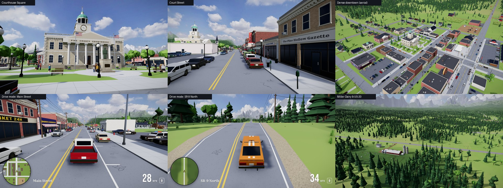

# Pine Hollow — Low-Poly Pacific Northwest Town (Three.js)

A rural American PNW town in a forested valley, built entirely in **Three.js** in the stylised low-poly look of the reference shots. It has a brick Main Street with Don's Donuts and its giant rooftop donut, 86 Gasoline, a sheriff's office, a motel and the Burger Barn drive-in. North of Main is a dense downtown: Court Street restaurants and shops, the Liberty Theater, Hotel Cascade, and a **courthouse square** with a clock-tower courthouse, a gazebo, a fountain and a memorial. Around the square are the **Town Hall**, a **police station**, a fire station, a library and a church. Beyond downtown are homes, four farms, a lumber yard, a used-car lot and the Tex Outpost. Two highways (US-20 and SR-9) and a **high-voltage line with its substation** cross the valley, and pine forest runs all the way to the snow-capped mountains. **Every road can be driven**: press `V`.



## Run

```bash
npm install
npm run dev        # http://localhost:5173
npm run build      # static build in dist/
```

URL options:
- `?shot=<id>`: main, intersection, square, townhall, courtst, downtown, carlot, alley, houses, farm, theater, civic, aerial, lumber, warehouse, corner, porch, tex, dairy, hayfarm, orchard, pylons, substation, valley, lake, highway.
- `?quality=low|medium|high`, `?ui=0`, `?tour=1`, `?traffic=0`, `?ao=0`.
- `?still=1` renders a few frames and then idles. Use it for headless or software-GL screenshots.

## Controls

**Exploring:** `1`–`0` camera presets · `N` next shot · `T` cinematic tour · `F` free-fly (WASD, Q/E, Shift) · `H` hide UI · mouse drag to orbit.

**Driving (`V` to get in or out):**
- `W`/`S` throttle and brake (hold `S` to reverse) · `A`/`D` steer · `Space` handbrake (drift) · `Shift` boost.
- `C` cycles the camera: chase, far chase, cockpit. Drag the mouse to look around; the wheel zooms.
- `R` resets to the nearest road · `M` full map.

The HUD shows speed, gear, your location and a heading-up minimap.

There are 15 vehicles: pickup, muscle coupe, sedan, jeep, sheriff and police cruisers, sheriff SUV, SUV, van, woody wagon, tow truck, FDS delivery van, fire engine, tractor and semi. Each one has its own top speed, acceleration, grip and off-road ability. Cars collide with buildings, props, parked cars, tree trunks and traffic, and AI traffic brakes for you. Suspension follows the terrain, so you can catch air over crests. A procedural engine and tyre sound runs through Web Audio.

The panel (top right) handles vehicle and paint selection, sun bearing and elevation, exposure, haze, AO, bloom, tone mapping and traffic. It can also **export the whole world as `.glb`** for Unity, Unreal, Godot or Blender.

## Use it in your game

```ts
import { createTownWorld } from './src/world';

const world = await createTownWorld({ traffic: true });
scene.add(world.root);
world.groundAt(x, z);          // drivable ground height (terrain + kerbs/plazas)
world.solidAt(x, z);           // buildings, props, trunks, water, map edge
world.nearestRoad(x, z);       // lane point + heading for spawning vehicles
world.roadAt(x, z);            // road/alley/highway/dirt under a point
// every frame:
world.update(dt, elapsedSeconds, camera.position, playerPosition);
```

`src/engine/` holds the reusable rigs:
- `SkyRig` (lighting) and `PostFX` (post-processing).
- `CameraDirector` (presets, tour and free-fly).
- `DriveMode` (vehicle controller) and `DriveHUD`.

The world is deterministic, so every load produces the same town.

## How it is built

- **Layout** (`src/world/layout`): the road network, Main Street, the Court Street rows, the courthouse square and civic block, service alleys, residential streets, the outskirts (farms, US-20 strip, SR-9, power grid) and street furniture.
- **Geometry:** procedural modelling kits (`src/world/buildings`, `vehicles.ts`, `props.ts`, `people.ts`, `farms.ts`, `infrastructure.ts`).
- **Performance:**
  - Almost every static surface uses one shared material. The tiling textures live in a `DataArrayTexture`, and roughness and metalness are per-vertex. All signage is packed into one sign atlas. Static geometry is merged per 150 m chunk, which comes to roughly 300 draw calls for the dense downtown, shadows included.
  - Vegetation (about 30k instances) uses two-level chunked LOD. Trees are detailed near the camera and become cheap stand-ins beyond about 260 m. Grass and bushes are culled by distance.
  - Resolution adapts when the frame rate drops.
- **Terrain:**
  - A flat valley floor and faceted forested foothills.
  - Farmyards sit on flattened pads.
  - SR-9's corridor is graded so the road ribbon lines up exactly with the terrain mesh.
  - There is a lake, and a distant ring of snow-capped mountains with a hero volcano.
- **Lighting:** a Poly Haven HDRI drives both the sky and image-based lighting, and the sun is rotated to match it. Shadows use a camera-fitted, texel-snapped map. Exponential haze softens distance.
- **Post (pmndrs/postprocessing):** N8AO ambient occlusion → NaN guard → bloom → ACES filmic → grade → vignette → SMAA.
- **Textures:** brick (six colours), siding, board-and-batten, metal roofing, corrugated steel, shingles, stone, stucco, cinder block, concrete, asphalt, gravel and plowed field are all generated procedurally. Signage uses Google Fonts.

## Credits

| Asset / library | Source | License |
|---|---|---|
| Sky HDRI “Kloofendal 48d Partly Cloudy (Pure Sky)” — Greg Zaal, Jarod Guest | polyhaven.com | CC0 |
| Fonts: Alfa Slab One, Oswald, Lobster, Rye, Bebas Neue | Google Fonts via Fontsource | OFL-1.1 |
| three.js | github.com/mrdoob/three.js | MIT |
| postprocessing | github.com/pmndrs/postprocessing | Zlib |
| N8AO | github.com/N8python/n8ao | ISC |
| lil-gui, simplex-noise | npm | MIT |
| Agent skill references (lighting, performance, post-processing) | github.com/CloudAI-X/threejs-skills | — |

The lighting HDRI (`public/assets/sky/sky_ibl_1k.hdr`) has the sun disc clamped and the mirrored lower hemisphere replaced with ground bounce. The background JPG is a downscaled, slightly lightened copy of the Poly Haven tonemapped image.
